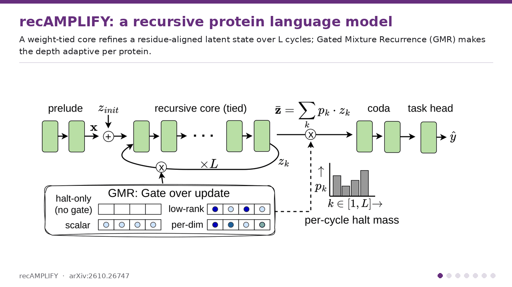
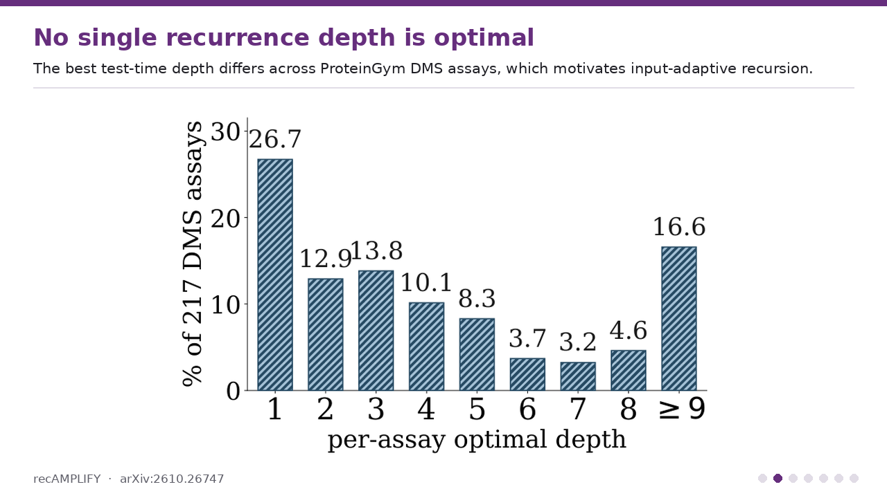
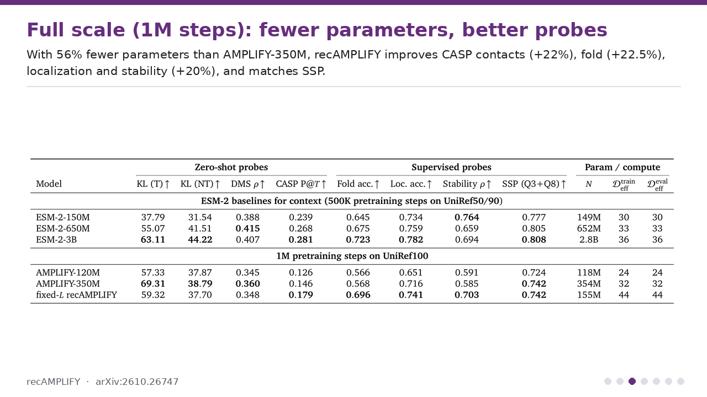
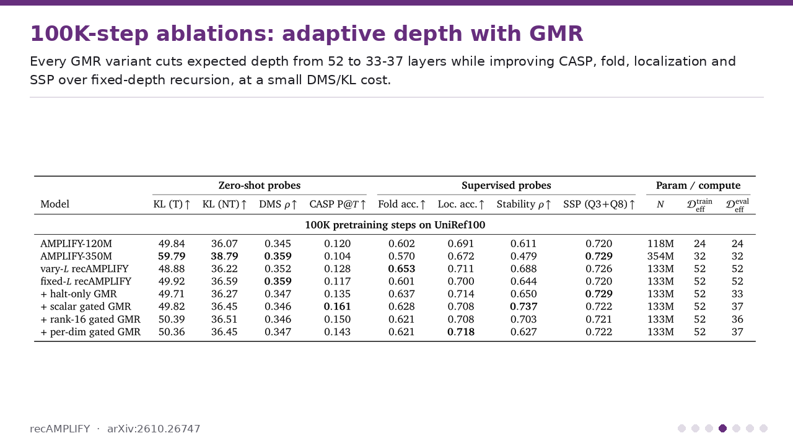
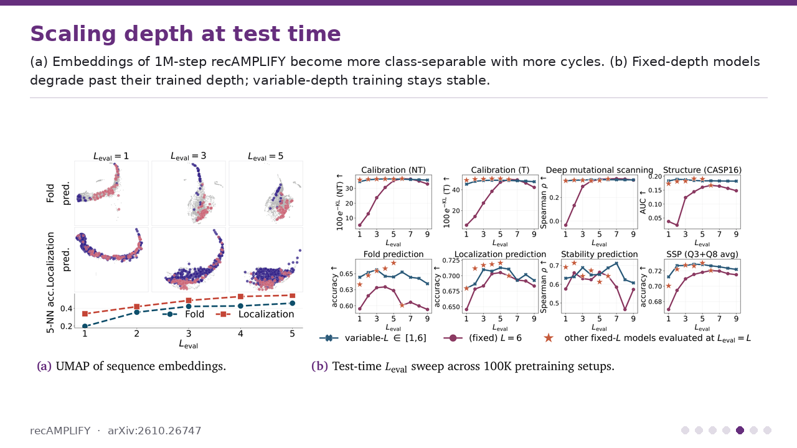
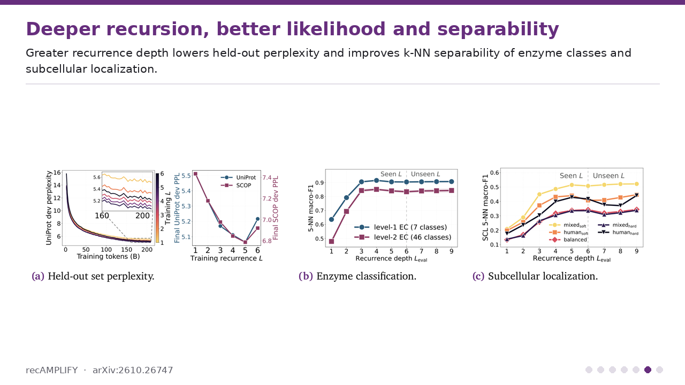
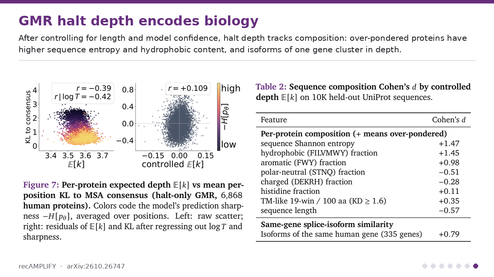

# recAMPLIFY

<p align="center">
  <a href="https://arxiv.org/abs/2610.26747"></a>
  <a href="https://huggingface.co/chandar-lab/recamplify"></a>
</p>

**recAMPLIFY: Large-Scale Pretraining of Recursive Protein Language Models**

Official code for *recAMPLIFY*: a compact masked protein language model that scales
**computation per sequence** rather than parameter count. A non-recurrent *stem* and *exit*
wrap a weight-tied **recurrent core** that refines a residue-aligned latent state over `L`
cycles, raising effective depth at a fixed parameter budget. On top of this,
**Gated Mixture Recurrence (GMR)** decodes each protein from a probability-weighted mixture
of the hidden states visited during recursion, gating every cycle's residual update by a
learned survival signal — making recursion depth adaptive per sequence at inference time.

At full scale (1 M pretraining steps on the same 2 T tokens as AMPLIFY), a 155 M-parameter
recAMPLIFY, with 56% fewer parameters than AMPLIFY-350 M, improves on it in CASP contact precision
(+22%), fold accuracy (+22.5%), stability Spearman (+20.3%) and localization accuracy (+3.5%),
matches it on secondary-structure prediction, and stays close on DMS and non-target KL calibration.
The GMR study uses a 100 K-step (210 B-token) budget at 133 M parameters, where GMR reduces the
expected number of recurrent cycles by 32–40% while improving contact recovery and most supervised
probes over fixed-depth recursion, at a small cost in zero-shot DMS and KL calibration.

## Results at a glance

<p align="center">
  
</p>

Each slide is taken directly from the paper ([arXiv:2610.26747](https://arxiv.org/abs/2610.26747)); expand one to view it at full size.

<details><summary><b>1. Architecture</b>: a weight-tied recurrent core, with Gated Mixture Recurrence for adaptive depth</summary>
<p align="center"></p>
</details>
<details><summary><b>2. No single depth is optimal</b>: the best test-time depth varies across ProteinGym DMS assays</summary>
<p align="center"></p>
</details>
<details><summary><b>3. Full scale (1M steps)</b>: 56% fewer parameters than AMPLIFY-350M, better CASP, fold, localization and stability</summary>
<p align="center"></p>
</details>
<details><summary><b>4. 100K-step ablations</b>: GMR cuts expected depth from 52 to 33–37 layers while improving most probes</summary>
<p align="center"></p>
</details>
<details><summary><b>5. Scaling depth at test time</b>: variable-depth training stays stable past the trained depth</summary>
<p align="center"></p>
</details>
<details><summary><b>6. Depth vs. performance</b>: more recursion lowers perplexity and improves separability</summary>
<p align="center"></p>
</details>
<details><summary><b>7. Halt depth encodes biology</b>: adaptive depth tracks sequence entropy and hydrophobic content</summary>
<p align="center"></p>
</details>

## Model variants

| variant | gating | description |
|---|---|---|
| `baseline` | — | fixed-depth recursion, `L` cycles for every sequence |
| `halt_only` | none | a halt head alone allocates depth, recovering PonderNet-style halting as the no-gate special case of GMR |
| `gate_scalar` | scalar | one survival channel per sequence |
| `gate_lowrank` | rank-16 | 16 channels mapped to features by a row-stochastic assignment |
| `gate_perdim` | per-dim | one survival channel per feature |

Each GMR cycle produces a conditional halt probability from a stop-gradient latent, so the
compute cost of adaptivity cannot corrupt the language-modeling features, while the task loss
still shapes the depth policy through the mixture weights.

## Installation

```bash
pip install -e .                      # training
pip install -r eval/requirements.txt  # evaluation
pip install -e '.[flash-attn]'        # FlashAttention, required for packed sequences
```

Requires CUDA and bf16 for packed-sequence training.

## Pretraining

```bash
VARIANT=halt_only sbatch --partition=<partition> jobs/run_slurm.sh   # SLURM, 2 GPUs
VARIANT=gate_perdim bash jobs/run_node.sh                             # 8 GPUs, no scheduler
```

Site-specific locations are read from the environment: `ENV_ACTIVATE`, `DATA_DIR` and
`OUTPUT_ROOT` for `run_slurm.sh`; `PATH_TO_ENV`, `PATH_TO_DATA` and `PATH_TO_LOGS` for
`run_node.sh`. Set `WANDB_ENTITY` to log to your Weights & Biases team.

`VARIANT` selects one of the five models above; `jobs/variant.sh` holds the table. Any knob is
overridable from the environment, e.g. `L_CYCLES=8 BETA=0.1`. Architecture, optimizer and data
settings are in `conf/amplify/`.

The objective is masked-language-modeling cross-entropy plus, for the GMR variants, an entropy
regulariser on the halting distribution weighted by `beta`, warmed up over the learning-rate
warmup horizon.

## Evaluation

21 probes: 3 zero-shot and 18 supervised.

```bash
CHECKPOINT=<run>/hf_checkpoints/checkpoint_100000 MODEL_NAME=halt_only \
  sbatch eval/jobs/run_eval.sh
```

**Zero-shot** — CASP16 contact recovery via the categorical Jacobian; ProteinGym deep
mutational scanning over 217 assays; KL calibration against human MSA consensus profiles.
**Supervised** — 18 probing tasks (6 regression, 10 sequence classification, 2 token
classification) with an MLP head and Bayesian hyperparameter search.

See [eval/README.md](eval/README.md) for the task list, metrics and data paths.

## Repository layout

| path | contents |
|---|---|
| `src/amplify/model/recamplify.py` | the recursive model and GMR |
| `src/amplify/model/amplify.py` | the AMPLIFY encoder block, RoPE and tokenizer primitives |
| `src/amplify/trainer/` | pretraining and checkpoint evaluation loops |
| `src/amplify/dataset/` | MLM collator, sequence packing, CSV/FASTA loading |
| `conf/amplify/` | Hydra configuration |
| `jobs/` | cluster launchers |
| `eval/` | the 21-probe evaluation suite |
| `scripts/` | entrypoints |

Checkpoints are standard Hugging Face directories:

```python
from amplify.model import RecAMPLIFY
model = RecAMPLIFY.from_pretrained("<run>/hf_checkpoints/checkpoint_100000")
```

## Pretrained checkpoints

All 11 models of the paper's main table are on the Hub in
[`chandar-lab/recamplify`](https://huggingface.co/chandar-lab/recamplify), one subfolder per model.
They load with plain `transformers`, no install of this repo needed:

| subfolder | model (paper row) | pretraining | parameters |
|---|---|---|---|
| `amplify-120m-1m` | AMPLIFY-120M | 1 M steps | 118 M |
| `amplify-350m-1m` | AMPLIFY-350M | 1 M steps | 354 M |
| `recamplify-1m` | fixed-`L` recAMPLIFY, `(p,r,c)=(2,10,2)`, `L = 4` | 1 M steps | 155 M |
| `amplify-120m-100k` | AMPLIFY-120M | 100 K steps | 118 M |
| `amplify-350m-100k` | AMPLIFY-350M | 100 K steps | 354 M |
| `recamplify-vary-l-100k` | vary-`L` recAMPLIFY, `L` ~ U{1,…,6} | 100 K steps | 133 M |
| `recamplify-fixed-l-100k` | fixed-`L` recAMPLIFY, `L = 6` | 100 K steps | 133 M |
| `gmr-halt-only` | + halt-only GMR | 100 K steps | 133 M |
| `gmr-scalar` | + scalar gated GMR | 100 K steps | 133 M |
| `gmr-rank16` | + rank-16 gated GMR | 100 K steps | 133 M |
| `gmr-perdim` | + per-dim gated GMR | 100 K steps | 133 M |

The AMPLIFY baselines are retrained with the AMPLIFY recipe in this codebase; they are not the
official `chandar-lab/AMPLIFY_120M` / `chandar-lab/AMPLIFY_350M` weights.

```python
import torch
from transformers import AutoModelForMaskedLM, AutoTokenizer

kw = dict(subfolder="gmr-perdim", trust_remote_code=True)   # any subfolder from the table
tokenizer = AutoTokenizer.from_pretrained("chandar-lab/recamplify", **kw)
model = AutoModelForMaskedLM.from_pretrained("chandar-lab/recamplify", **kw).eval()

inputs = tokenizer(["MSKGEELFTGVVPILVELDGDVNGHKFSVSGEGEGDATYGKLTLKFICTTGKLPVPWPTLVTT"], return_tensors="pt")
with torch.no_grad():
    out = model(**inputs)        # out.logits; out.avg_cycles = expected cycles (GMR variants)

model.set_num_cycles(9)          # test-time depth: more (or fewer) cycles than used in training
```

A training checkpoint becomes such a repo with
`python scripts/export_hf.py --checkpoint_dir <ckpt> --output_dir <dir> --repo_id <org>/<name>`
(which also writes the model card), then `python scripts/upload_to_hf.py --checkpoint_dir <dir>
--repo_id <org>/<name>`.

## Citation

```bibtex
@misc{recamplify,
  title         = {recAMPLIFY: Large-Scale Pretraining of Recursive Protein Language Models},
  author        = {Jha, Saurav and Liao, Qianli and Vernon, Robert McCoy and Chandar, Sarath and Fournier, Quentin},
  year          = {2026},
  eprint        = {2610.26747},
  archivePrefix = {arXiv},
  url           = {https://arxiv.org/abs/2610.26747},
}
```

## License

See [LICENSE](LICENSE).
